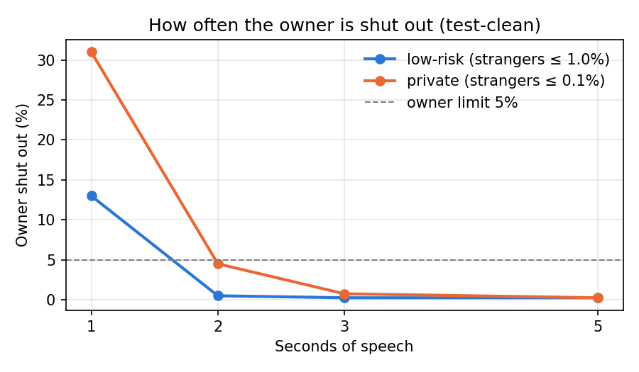

# Whose voice is this?

A voice check for a headset agent: how little speech it needs, how safe it is, and what the agent does about recorded or cloned voices.

## Run it

Python 3.11 (torch 2.5.1 has no builds for Python 3.13 or newer).

```bash
uv venv -p 3.11 .venv
source .venv/bin/activate        # Windows: .venv\Scripts\activate
uv pip install -r requirements.txt
python src/evaluate.py               # downloads ~700 MB once, writes results.md (~10 min on my laptop)
python -m pytest                 # tests, no data or model needed
```

Or on GitHub, without installing anything: open the Actions tab, choose evaluate, then Run workflow. It runs the same evaluation on GitHub’s servers (20 min) and attaches results.md, results.png and thresholds.json to the run. The tests run on every push by themselves.


## The answer

Low-risk actions need 2 s of speech (strangers let in 0.77 %, owner shut out 0.5 %). Private actions need 3 s (strangers 0.09 %, owner shut out 0.75 %); 2 s meets the limits on the measured numbers, but the owner shut-out could be up to 7 %. 40 test speakers cannot prove the 0.1 % stranger limit: its interval reaches 0.15 %. Noise mainly shuts the owner out (13.5 % at 10 dB). A phone-quality replay of the owner passes 96 % of the time, so the voice check alone never protects private actions or money.

## What "safe" means

| Action | Examples | Strangers let in (FAR) | Owner shut out (FRR) |
|---|---|---|---|
| Public | time, weather | no check | – |
| Low-risk | calendar, who messaged | ≤ 1 % | ≤ 5 % |
| Private | read messages, send email | ≤ 0.1 % | ≤ 5 % |
| Money | pay | voice is never enough: always confirm on the phone | – |

Why:
- **Different harm, different limit.** Hearing my calendar is not the same as reading my messages, or paying.
- **A stranger gets few tries.** After 3 failures in a row, everything needs the phone and the owner is notified.
- **The owner talks to it all day,** so being shut out must be rare, and "shut out" first means "say it again", not "sign in again".
- **A clone can pass any voice threshold,** so voice alone never pays.

## How much speech

- **Model:** pretrained ECAPA-TDNN from SpeechBrain (`speechbrain/spkrec-ecapa-voxceleb`), trained on VoxCeleb, which shares no recordings with LibriSpeech. It turns speech into a 192-number voiceprint. Score = cosine similarity with the owner's voiceprint.
- **Data:** LibriSpeech. dev-clean (40 speakers) to set thresholds, test-clean (40 other speakers) to report.
- **Enrollment:** 30 s from one chapter. **Test:** 10 clips per speaker from other chapters, cut to 1, 2, 3, 5 s.
- **Threshold:** set on dev-clean at each FAR limit, then used unchanged on test-clean.

### Speech length

| Speech | Limit | Strangers let in (FAR) | Owner shut out (FRR) | Meets limits |
|---|---|---|---|---|
| 1 s | low-risk | 0.737% (115) [0.609%–0.884%] | 13.00% (52) [9.86%–16.70%] | no |
| 1 s | private | 0.071% (11) [0.035%–0.126%] | 31.00% (124) [26.50%–35.79%] | no |
| 2 s | low-risk | 0.769% (120) [0.638%–0.919%] | 0.50% (2) [0.06%–1.79%] | yes |
| 2 s | private | 0.090% (14) [0.049%–0.151%] | 4.50% (18) [2.69%–7.02%] | yes |
| 3 s | low-risk | 0.769% (120) [0.638%–0.919%] | 0.25% (1) [0.01%–1.38%] | yes |
| 3 s | private | 0.090% (14) [0.049%–0.151%] | 0.75% (3) [0.15%–2.18%] | yes |
| 5 s | low-risk | 0.885% (138) [0.744%–1.044%] | 0.25% (1) [0.01%–1.38%] | yes |
| 5 s | private | 0.135% (21) [0.083%–0.206%] | 0.25% (1) [0.01%–1.38%] | no |



### Background noise (3 s, white noise)

Noise mainly shuts the owner out, not strangers in: at an SNR of 10 dB the owner is shut out 13.5 % of the time at the private limit, instead of 0.75 %.

| SNR (speech vs noise) | low-risk FAR | low-risk FRR | private FAR | private FRR |
|---|---|---|---|---|
| none | 0.769% | 0.25% | 0.090% | 0.75% |
| 20 dB | 0.686% | 0.50% | 0.071% | 3.00% |
| 10 dB | 0.558% | 4.00% | 0.083% | 13.50% |
| 5 dB | 0.410% | 10.50% | 0.045% | 29.50% |

## How I tested it

- One command, pinned versions, fixed random seed.
- Thresholds set on one group of speakers and measured on another; the code stops if they overlap. No recording is used for both enrollment and test.
- Tests (`test_check.py`) check the threshold and error-rate maths and every agent rule. They run on GitHub on every push.
- **Limits of the numbers:** the 95 % intervals assume every trial is independent. They are not: 10 clips from the same person are related, so the real uncertainty is larger. With 40 speakers I can estimate 1 %, but I cannot prove 0.1 %. To prove it, I would test on more speakers.

## Recorded or cloned voices

The voice check alone does not stop them. A phone-quality replay of the owner was accepted 96 % of the time at the private limit.

So the agent (`src/agent.py`) adds layers:
1. **Money always needs the phone.**
2. **When unsure, a random phrase** spoken into the wearer's ear. A prepared recording can't contain it. If that fails too: the phone.
3. **Lockout:** 3 failures, then phone only, and the owner is notified (rule only; counting attempts and notification are not built).
4. **The agent never says why a check failed**, so it doesn't coach an attacker.

Next (not built): a wear sensor (nothing private runs off the head) and a spoof detector, tested on cloning tools it was not trained on.

## What I am least sure of

1. **Real headset audio.** LibriSpeech is clean audiobook reading. Short commands through a headset microphone will score lower. To find out: record colleagues (with consent) through the real headset and redo the thresholds.
2. **Clones.** They improve fast. To find out: attack the whole system regularly with current cloning tools, on own voices only.
3. **The 0.1 % limit**, which 40 speakers cannot prove (above).

## Demo (own voice only)

Record with any app: about 30 s of yourself, a short live attempt, the same attempt played from a phone next to the microphone, and (optionally) a clone of your own voice.

```bash
python src/demo.py enroll.wav live.wav replayed.wav 
```

Output:

```
live.wav: score 0.783, voice passes: private
   read_messages -> do it
   pay           -> confirm on phone
replayed.wav: score 0.676, voice passes: private
   read_messages -> do it
   pay           -> confirm on phone
```

This confirms the replay result above: a recording of me played from a phone scored 0.676 and passed the private limit, so the agent would have read my messages. What I built protects money (always the phone) and contains the rule that 3 failed attempts lock the voice. Counting the attempts and notifying the owner are not built yet. It does not yet stop a good replay from reaching private actions. The fix, from my proposal, is to start every private session with a random phrase spoken in the ear, not only when the check is unsure. A prepared recording cannot answer it. That is the first thing I would build next. I did not test a cloned voice.

## How I made it

Set-up: Windows laptop, Python 3.11 (uv), GitHub Actions for the tests.

I designed the approach in my first-round proposal: the risk levels and limits, testing on unseen speakers, the replay test and the agent’s fallbacks. I got help from Claude (Anthropic), an AI assistant, to write the code. I went through every suggestion until I could explain it, simplified it and changed parts I didn’t agree with, then ran the evaluation and checked the results myself.

## Files

| File | What it does |
|---|---|
| `src/check.py` | voiceprint, score, thresholds, error rates |
| `src/agent.py` | what the agent may do, given the check |
| `src/evaluate.py` | the one command: data, scores, results |
| `src/demo.py` | try it on your own voice |
| `test_check.py` | tests |

## Credits

- LibriSpeech: Panayotov et al., "Librispeech: an ASR corpus based on public domain audio books", ICASSP 2015. CC BY 4.0.
- ECAPA-TDNN: Desplanques et al., Interspeech 2020. SpeechBrain: Ravanelli et al., 2021.
