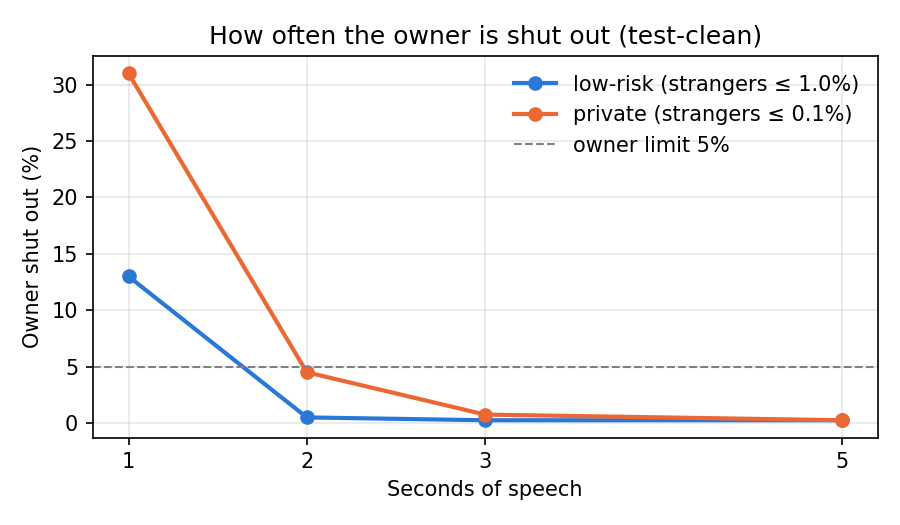

# Results

Thresholds set on dev-clean, errors measured on test-clean: 400 owner trials, 15600 stranger trials, 95% intervals in brackets.

## Speech length

| Speech | Limit | Strangers let in (FAR) | Owner shut out (FRR) | Meets limits |
|---|---|---|---|---|
| 1 s | low-risk | 0.737% (115) [0.609%–0.884%] | 13.00% (52) [9.86%–16.70%] | no |
| 1 s | private | 0.071% (11) [0.035%–0.126%] | 31.00% (124) [26.50%–35.79%] | no |
| 2 s | low-risk | 0.769% (120) [0.638%–0.919%] | 0.50% (2) [0.06%–1.79%] | yes |
| 2 s | private | 0.090% (14) [0.049%–0.151%] | 4.50% (18) [2.69%–7.02%] | yes |
| 3 s | low-risk | 0.769% (120) [0.638%–0.919%] | 0.25% (1) [0.01%–1.38%] | yes |
| 3 s | private | 0.090% (14) [0.049%–0.151%] | 0.75% (3) [0.15%–2.18%] | yes |
| 5 s | low-risk | 0.885% (138) [0.744%–1.044%] | 0.25% (1) [0.01%–1.38%] | yes |
| 5 s | private | 0.135% (21) [0.083%–0.206%] | 0.25% (1) [0.01%–1.38%] | no |

**Shortest speech for low-risk: 2 s.**
**Shortest speech for private: 2 s.**

## Background noise (3 s, white noise)

| Noise | low-risk FAR | low-risk FRR | private FAR | private FRR |
|---|---|---|---|---|
| none | 0.769% | 0.25% | 0.090% | 0.75% |
| 20 dB | 0.686% | 0.50% | 0.071% | 3.00% |
| 10 dB | 0.558% | 4.00% | 0.083% | 13.50% |
| 5 dB | 0.410% | 10.50% | 0.045% | 29.50% |

## Phone-quality replay of the owner (3 s)

Mean score: live owner 0.680, replayed owner 0.589.

- Replay accepted at the low-risk threshold: 99.2%
- Replay accepted at the private threshold: 96.0%

